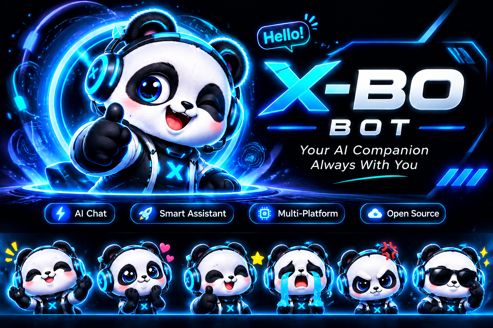

<p align="center">
  
</p>

<h1 align="center">X-BO Bot</h1>

<p align="center">
  <strong>One chat. More ways to get work done.</strong><br />
  A web-based AI agent with a focused chat experience, streaming responses, and a provider-ready backend.
</p>


<p align="center">
  <strong>One chat. More ways to get work done.</strong><br />
  A web-based AI agent with a focused chat experience, streaming responses, and a provider-ready backend.
</p>

<p align="center">
  <a href="https://github.com/zskbot/X-BO"></a>
  
  
  
  
</p>

X-BO is an AI-agent web application built around a simple idea: make it easy to talk to an AI, stream its response, and connect the experience to different model providers. The repository includes a React/Vite frontend and a Node.js backend with chat API routes and provider routing.

> **Project status:** Active development. Configure the required provider credentials before expecting AI responses in a deployed environment.

## Contents

- [Highlights](#highlights)
- [Technology](#technology)
- [Getting started](#getting-started)
- [Configuration](#configuration)
- [API](#api)
- [Deploying](#deploying)
- [Project layout](#project-layout)
- [Development checks](#development-checks)
- [Security](#security)
- [Contributing](#contributing)
- [License](#license)

## Product direction: X-BO by OCode.js

The workspace is evolving toward a prompt-first full-stack builder: start from a natural-language request or template, review planned work, inspect generated files and diffs, validate a real preview, and sync through a GitHub branch/PR workflow. The current UI includes a redesigned prompt-first chat entry and starter prompts. Visual asset processing, generated-code preview/editor, GitHub write-back, and OCode.js deployment must not be considered available until their integrations are implemented and tested.

- **Builder architecture and UI specification:** [docs/XBO-OCODEJS-BUILDER.md](docs/XBO-OCODEJS-BUILDER.md)

## Highlights

- **Chat streaming** — the Gemini chat endpoint can stream incremental response events using Server-Sent Events (SSE).
- **Provider-ready architecture** — routing includes OpenAI, Claude, Gemini, Qwen, OHMABA, and the local `zsk` provider; availability depends on each provider's implementation and configuration.
- **HTTP chat API** — accepts chat prompts and can return either a JSON response or a streaming response.
- **Modern web stack** — React 18, Vite, and Node.js/Express.
- **Self-hosting options** — run the web client and API locally, or configure the repository for a supported hosting environment.
- **Configurable model selection** — environment variables and request parameters determine which model/provider is used.

## Technology

| Layer | Technologies |
| --- | --- |
| Web client | React, Vite, TypeScript |
| API server | Node.js, Express |
| AI integration | Google GenAI SDK and provider adapters |
| Realtime / streaming | Server-Sent Events (SSE), Socket.IO/WebSocket components |
| Testing and quality | Vitest, ESLint, Prettier |
| Deployment configuration | Vercel configuration included |

## Getting started

### Requirements

- Node.js 18 or newer
- npm
- An API key for the AI provider you plan to use

### 1. Clone the repository

```bash
git clone https://github.com/zskbot/X-BO.git
cd X-BO
npm install
```

### 2. Configure environment variables

Create a local `.env` file. Use placeholders only; never paste real API keys into source control.

```dotenv
# Gemini credentials (required when using the Gemini runtime)
GEMINI_API_KEY=your_gemini_api_key
# Optional alias accepted by the runtime
LLM_API_KEY=

# Default provider/model alias
DEFAULT_MODEL=gemini

# Optional custom/self-hosted agent endpoint
OHMABA_URL=
OHMABA_API_KEY=
```

The Gemini runtime uses `LLM_API_KEY` first, then `GEMINI_API_KEY`. The default Gemini model is `gemini-2.5-flash`; set `GEMINI_MODEL` to override it.

### 3. Start the application

Open two terminal sessions from the repository root.

**Terminal A — API server**

```bash
npm run api
```

**Terminal B — frontend**

```bash
npm run dev
```

Vite prints the local development URL when it starts. Keep the API process running while testing features that call the backend.

## Configuration

| Variable | Purpose |
| --- | --- |
| `GEMINI_API_KEY` | Gemini API key used by the Gemini runtime |
| `LLM_API_KEY` | Optional preferred key name; takes precedence over `GEMINI_API_KEY` |
| `GEMINI_MODEL` | Optional Gemini model override; defaults to `gemini-2.5-flash` |
| `DEFAULT_MODEL` | Default provider/model alias used by API routing |
| `OHMABA_URL` | Optional custom or self-hosted agent endpoint |
| `OHMABA_API_KEY` | Optional bearer token for the custom endpoint |
| `PORT` | API server port; defaults to `3000` |

Only configure the variables needed by your chosen provider. Do not commit `.env`, credentials, access tokens, or deployment secrets.

## API

### `POST /api/chat`

The Vercel API handler accepts JSON with either `message` or `prompt`.

**Request**

```json
{
  "message": "Explain what this project does",
  "stream": false
}
```

**Non-streaming response**

```json
{
  "success": true,
  "response": "…",
  "model": "gemini-2.5-flash"
}
```

Set `"stream": true` or send an `Accept: text/event-stream` header to request SSE streaming for the Gemini path. Events include `delta` for incremental text, `done` when complete, and `error` if streaming fails.

The API validates empty prompts and rejects messages longer than 12,000 characters. The Express server also exposes `GET /health` and chat routes under `/v1/chat`.

> API behavior can differ by provider. Check the relevant provider implementation before relying on provider-specific streaming or response formats.

## Deploying

The repository includes a `vercel.json` configuration for the static frontend and API functions.

1. Import `zskbot/X-BO` into your hosting provider.
2. Configure the required environment variables in the provider's project settings.
3. Run a preview/staging deployment first.
4. Verify the chat API, provider credentials, and streaming behavior before promoting any release.

Do not put secrets in `vercel.json`, frontend variables, README examples, or committed source files. Never run a production deployment until the preview has been checked and explicitly approved.

## Project layout

```text
X-BO/
├── api/                 # Serverless API handlers
├── src/
│   ├── agent/            # Agent runtime and system prompt
│   ├── config/           # Provider/model configuration
│   ├── providers/        # Provider adapters
│   ├── router/            # Provider selection and orchestration
│   ├── routes/            # Express API routes
│   ├── server/            # Express server entry point
│   ├── tools/             # Agent tools
│   └── ...                # UI, shared utilities, and other modules
├── assets/               # README and project assets
├── wiki/                 # Project notes and wiki
├── index.html
├── package.json
├── vercel.json
└── vite.config.ts
```

## Development checks

```bash
npm run build
npm test
npm run lint
```

These commands are available in `package.json`. Run them after making changes and resolve failures before opening a pull request.

## Security

- Keep API keys and tokens in local environment files or hosting-provider secret settings.
- Rotate a credential immediately if it has been exposed in a commit, log, screenshot, or public issue.
- Validate and review agent tools carefully before enabling them in an environment with access to important files or services.
- Do not assume a provider is configured merely because its name appears in the routing layer.

## Contributing

1. Create a feature branch.
2. Make a focused change and add or update tests where appropriate.
3. Run the development checks.
4. Open a pull request with a concise description and verification notes.

## License

This repository identifies its license as **Apache-2.0**. See [LICENSE](./LICENSE) for the full terms.
